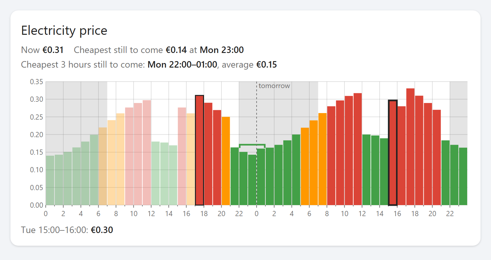
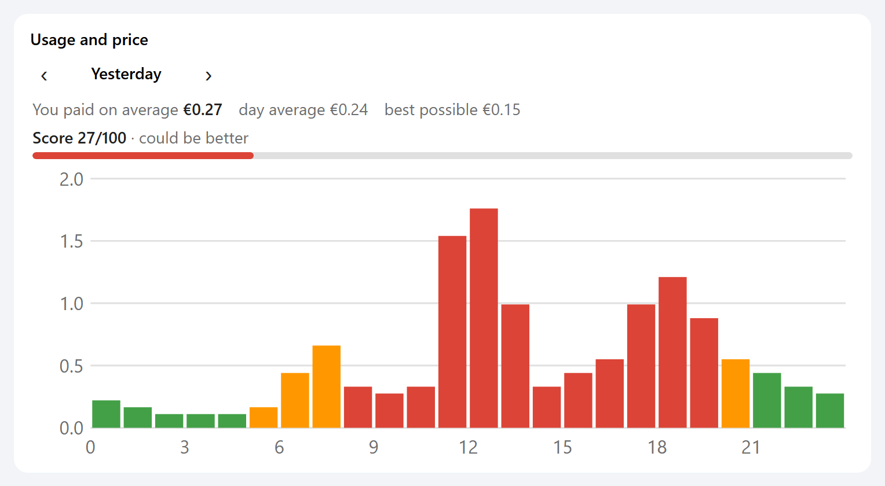

# Electricity Price Planner

**See when electricity is cheap today and tomorrow, and plan your washing
machine, dishwasher or car charging around it.**

A card and badges for Home Assistant dashboards that show the prices of a
dynamic electricity tariff for today and tomorrow, find the cheapest hours,
and show how well you used them. It works with the price integrations of many
suppliers and markets: Tibber, Octopus Energy, Frank Energie, Pure Energie,
Nord Pool, ENTSO-e, EPEX Spot, EnergyZero, easyEnergy and
[more](#supported-price-integrations).



*Price chart and badges, with made-up sample prices.*

**Contents:**
[Why](#why) ·
[Quick start](#quick-start) ·
[What's included](#whats-included) ·
[Installation](#installation) ·
[Configuration](#configuration) ·
[Tips](#tips-and-troubleshooting) ·
[Feedback and support](#feedback-and-support) ·
[Supported price integrations](#supported-price-integrations)

## Why

With a dynamic tariff the price changes every hour, or even every quarter
hour, and the cheapest hours can cost a fraction of the most expensive ones.
Home Assistant's built-in charts only show the past. This card shows what is
still to come:

- **See the prices ahead:** today and tomorrow as coloured bars, from cheap to
  expensive.
- **Plan:** the cheapest block of hours is marked, optionally within your own
  time window, for example overnight.
- **Know at a glance:** badges at the top of your dashboard show the price
  now, where it is heading, and what a run of your washing machine costs now
  and at the best moment.
- **Learn:** the usage card colours your own use by price and gives you a
  score for your timing.

## Quick start

1. Make sure a price integration is set up in Home Assistant (see
   [supported price integrations](#supported-price-integrations)).
2. Install the card with HACS (see [Installation](#installation)).
3. **Edit dashboard → Add card → Electricity Price Planner card** and choose
   your price sensor. That is all the card needs.
4. Optional: add badges (**Add badge → Electricity Price Planner badge**) and
   the usage card. They take their settings from the price card.

Every setting can be changed in the card's settings form; YAML is optional.

## What's included

### Price card

- Bars for today and tomorrow, per hour, half hour or quarter hour. Tomorrow
  fills in as soon as the prices are published, usually in the afternoon.
- Hover over, tap or drag across the bars to see the exact price of a period.
- The cheapest block of hours marked with a bracket, for example the best 3
  hours for the washing machine, optionally within set hours.
- A short text above the chart: the price now, the cheapest hour still to
  come and the cheapest block. Each line can be switched off.
- Optional: negative prices in their own colour, an average line per day,
  shaded night hours, a fixed scale to compare days, and a compact mode with
  only the bars.
- Feed-in mode for solar panels: high prices are good there, so the colours
  turn around and the card looks for the highest prices.

### Badges

Small badges for the top of a dashboard. Each badge shows one thing:

| Badge | Shows |
|---|---|
| Price now | The current price. |
| Next price (trend) | The next price, with ↑, ↓ or →. |
| Price at a set hour | For example always the price at 06:00. |
| Cheapest hour | Still to come, today, tomorrow or both. With "today": the day's minimum. |
| Highest price | The same, for the most expensive hour: the day's maximum. |
| Average price | The average of the hours you choose. |
| Cheapest block of hours | When to start, for example 3 hours, optionally within set hours. |
| Negative prices | How many hours are below zero, and when they start. |
| Cost of an appliance | What one run costs now and at the cheapest start, for example a washing machine. |

### Usage card

Your electricity use per hour, each bar coloured by the price of that hour.
It opens on today; the ‹ › arrows step back through earlier days. Above it: the
average price you paid, the day's average and the best possible price, and a
score from 0 to 100 for your timing. Meters with a high and a low tariff are
added up for you.



*Usage card with made-up sample use.*

### For everyone

- English, Dutch, German, French and Spanish, following your Home Assistant
  language. Prices in that language's format, for example `€0.28` or
  `0,28 €`.
- Euro, pound, Swedish, Norwegian and Danish krone, Swiss franc, Polish złoty
  and more, read from the sensor or chosen by hand.
- Colour palettes including one for red-green colour blindness, a simple
  modern grey scale, and your own colours.
- Follows your theme, light and dark, and works on phones and tablets.
- One JavaScript file, no external libraries, no network requests of its own.

## Installation

Requirements: Home Assistant 2024.11 or newer, and a
[price integration](#supported-price-integrations). For the usage card: an
energy meter in kWh, for example the one in the Energy dashboard.

### HACS (recommended)

1. In HACS, open the three-dot menu → **Custom repositories**.
2. Repository: `https://github.com/eva-schulze/electricity-price-planner`,
   type: **Dashboard**. Click **Add**.
3. Search for **Electricity Price Planner** and download it.
4. Reload the browser (Ctrl+F5 / Cmd+Shift+R).

From Home Assistant 2026.11, HACS is built in as the Marketplace. Adding your
own repository works there as well; it needs a GitHub connection.

### Manual

1. Copy `electricity-price-planner.js` to the `www` folder of your Home
   Assistant configuration (create the folder if needed, then restart Home
   Assistant once).
2. Turn on **Advanced mode** in your user profile.
3. Go to **Settings → Dashboards → three-dot menu → Resources → Add resource**:
   - URL: `/local/electricity-price-planner.js?v=1`
   - Resource type: **JavaScript module**
4. Reload the browser. After replacing the file with a newer version, raise
   `?v=1` to `?v=2` and so on, or the browser keeps the old one.

## Configuration

All settings are in the settings forms of the card, badge and usage card. The
tables below list them with their YAML names, in the same order and groups as
the forms.

On a sections dashboard the price card and the usage card take the full width
of their section. To make one narrower, drag it smaller or use the card's
**Layout** tab.

### Price card

```yaml
type: custom:electricity-price-planner-card
entity: sensor.pure_energie_electricity_import
```

Choose the sensor of your integration that carries the price list; under
**Settings → Devices & services → Entities** its attributes show the list.
For EnergyZero, easyEnergy, the built-in Nord Pool and Tibber, open
**Advanced settings** and choose the integration under **Where the prices
come from**; no sensor is needed then.

| Option | Default | Description |
|---|---|---|
| `entity` | *(required for sensors)* | The price sensor. |
| `mode` | `purchase` | `purchase` or `feed_in` (high prices are good: colours turned around, highest prices searched). |
| `show_title`, `title` | on, in your language | The card title. An empty title uses the default. |
| **Text** | | |
| `show_summary` | `true` | Text above the chart. |
| `summary_now`, `summary_cheapest`, `summary_block` | `true` | Single lines of that text. |
| `show_info` | `true` | The price line below the chart. |
| **Chart** | | |
| `height` | `180` | Chart height in pixels. With a fixed height on the Layout tab, the chart fills that height instead. |
| `compact` | `false` | Only the bars, without price and hour labels. For small cards. |
| `fixed_scale`, `y_max` | off | Fixed top of the scale per kWh, for example `0.40`. A higher price still stretches the scale. |
| `show_average` | `false` | A dashed line at each day's average price. |
| `highlight_negative` | `true` | Negative prices in their own colour (purple), with a line at zero. |
| `night_shading`, `night_start`, `night_end` | on, `22`, `6` | Shaded night hours (`night_end` included). |
| **Colours** | | |
| `palette` | `traffic` | `traffic` (green – orange – red), `colorblind` (blue – orange), `grey` (simple modern grey scale) or `custom`. |
| `color_low`, `color_high` | blue, orange | Your own colours with `palette: custom`. A CSS colour or `[r, g, b]`. |
| `color_steps` | `3` | Number of colour bands, 2 to 6. |
| **Cheapest block** | | |
| `block_hours` | `0` | Length of the cheapest block in hours, up to 12. `0` = off. |
| `block_window`, `block_from`, `block_until` | off, `22`, `7` | Only within set hours: start from `block_from`, finished by `block_until`. |
| `block_color` | colour of the cheapest prices | Colour of the bracket. |
| **Advanced settings** | | |
| `source` | `attribute` | `attribute` (a sensor), or an action: `energyzero`, `easyenergy`, `nordpool`, `tibber`. |
| `config_entry` | – | For `energyzero`, `easyenergy`, `nordpool`: the integration entry (a list in the form). |
| `area` | first | `nordpool`: the price area, for example `NL` or `SE3`. `tibber`: the name of the home. |
| `incl_vat` | `true` | `energyzero`, `easyenergy`: prices including VAT. |
| `attribute`, `time_key`, `price_key` | found automatically | Your own data format: the attribute with the list (several separated by commas), the field with the start time (a dot for nested fields) and the field with the price. |
| `price_unit` | `auto` | `auto` (from the sensor), `kwh`, `cent` (ct, p, öre) or `mwh`. |
| `currency` | `auto` | `auto` (from the sensor, else euro) or a code such as `EUR`, `GBP`, `SEK`, `NOK`, `DKK`, `CHF`, `PLN`, `AUD`. |
| `decimals` | `2` | Decimals for prices in the text. |
| `font_size` | `14` | Text size in pixels, 10 to 24. |
| `price_factor` | `1` | YAML only: multiply all prices, for unusual units. |

### Badges

```yaml
badges:
  - type: custom:electricity-price-planner-badge
    show: appliance
    appliance_kwh: 1
    appliance_hours: 2
    name: Washing machine
```

A badge takes its colours, currency, unit and data source from a price card
on the same dashboard, so the sensor can stay empty.

| Option | Default | Description |
|---|---|---|
| `show` | `now` | `now`, `trend`, `at`, `cheapest`, `highest`, `average`, `block`, `negative` or `appliance` (see [Badges](#badges)). |
| `range` | `upcoming` | For `cheapest`, `highest`, `average`, `block`, `negative`: `upcoming`, `today`, `tomorrow` or `both`. |
| `block_hours` | `3` | For `block`: hours in the block. |
| `appliance_kwh`, `appliance_hours` | `1`, `2` | For `appliance`: energy per run and its duration. |
| `block_window`, `block_from`, `block_until` | off | For `block` and `appliance`: only within set hours. |
| `hour` | `6` | For `at`: the next time the clock reaches this hour (averaged over the hour for quarter-hour prices). |
| `entity` | from the price card | The price sensor. |
| `name`, `icon` | automatic | Your own label and icon. |
| `follow_chart` | `true` | Take colours and data settings from a price card on the dashboard: the one for the same sensor, or the last one that loaded. Switch off to set `mode`, colours and the advanced settings on the badge. |

While a price is not known yet (for example tomorrow's prices in the morning),
a badge shows a dash; hover over it to read "not known yet".

### Usage card

```yaml
type: custom:electricity-price-planner-usage-card
energy_entity:
  - sensor.electricity_meter_energy_consumption_tarif_1
  - sensor.electricity_meter_energy_consumption_tarif_2
```

| Option | Default | Description |
|---|---|---|
| `show_title`, `title` | on, in your language | The card title. An empty title uses the default. |
| `energy_entity` | *(required)* | One or more energy meters in kWh, for example the ones in the Energy dashboard. Several are added up, such as the high and low tariff (tariff 1 and 2) of a Dutch or Belgian meter. Do not also add a total of them, or use is counted twice. |
| `show_score` | `true` | The score: 100 = all use in the day's cheapest hour, 0 = all in the most expensive one. |
| `height` | `160` | Chart height in pixels. |
| `font_size` | `14` | Text size in pixels, 10 to 24. The chart's labels grow and shrink along. |
| `follow_chart` | `true` | Prices and colours from the price card on the dashboard. Switch off to set the price sensor, `palette`, `color_steps`, `decimals` and the advanced settings on this card, with the same names as on the price card. |

Use the ‹ › arrows on the card to go back to earlier days, as far as your
recorder's statistics go. For a past day the card takes prices from the price
list while it still covers that day, and otherwise from the price sensor's
history. So past days need a price sensor; with an action as the data source,
older days show grey bars without prices.

## Tips and troubleshooting

- **Prices 100 or 1000 times too high:** the integration gives cents or
  prices per MWh. Set **Unit of the prices** under Advanced settings.
- **"No prices available yet" although the sensor has a price list:** switch
  on **Set the data format myself** under Advanced settings and fill in the
  attribute and field names.
- **Tomorrow is empty:** tomorrow's prices are usually published in the
  afternoon; the chart fills in by itself.
- **Feed-in prices:** add a second price card with your integration's feed-in
  sensor and set **Prices shown** to **Feed-in price**.
- **Market prices:** integrations such as ENTSO-e, Nord Pool, EPEX Spot or
  EnergyZero usually give the market price, without your supplier's
  surcharges and taxes, unless you add them in the integration. The colours
  and the cheapest hours are the same either way.
- **What the colours mean:** they compare each period with the other periods
  shown, not with other days. To compare days, use a fixed scale.
- **Times** are shown in the time zone of the device viewing the dashboard.
- **Reporting a problem:** the version is printed in the browser console when
  the card loads; please mention it.

## Privacy

The card itself makes no network requests. It only reads your own Home
Assistant: the price sensor, an integration's price action and, for the usage
card, the recorder statistics of your energy meter. Fetching the prices from
the internet is done by your price integration.

## Feedback and support

**Tested:** I could only test version 2 on my own installation, with Pure
Energie Prices. The other integrations are recognised from their code and
were tested with sample data. If you use one of them, please open an issue and
say whether the prices look right. Version 1.1.0 supports Pure Energie Prices
only.

**Support:** I maintain this card in my free time. I'll try to help, but
answers can take a while, and there is no guaranteed support. The card is
provided as is, without warranty. You're welcome to:

- report a problem or suggest an improvement by opening an issue;
- send a change as a pull request;
- use the code as the basis for your own version (MIT licence).

Suggestions that help others too, I'll try to add to the project.

**Roadmap:**

- Notifications, for example when the cheapest block starts. This needs a
  Home Assistant automation (a blueprint), not the card, and is planned.
- More integrations on request.

## Supported price integrations

Status: **tested** = on a real installation; **recognised** = from the
integration's code, tested with sample data; **own format** = works with
**Set the data format myself**.

| Country | Supplier or market | Home Assistant integration | Status |
|---|---|---|---|
| Netherlands | Pure Energie | [Pure Energie Prices](https://github.com/venraij/hacs-pure-energy-prices) | tested |
| Netherlands | Frank Energie | [Frank Energie](https://github.com/HiDiHo01/home-assistant-frank_energie) | recognised |
| Netherlands | market price (EnergyZero, used by ANWB Energie and others) | EnergyZero (built-in, action) | recognised |
| Netherlands | market price (easyEnergy) | easyEnergy (built-in, action) | recognised |
| Netherlands | Zonneplan | [Zonneplan ONE](https://github.com/fsaris/home-assistant-zonneplan-one) | own format |
| Germany | Octopus Energy | [Octopus Germany](https://github.com/thecem/octopus_germany) | recognised |
| Germany | Rabot Energy | [Rabot Energy](https://github.com/rabotcharge/ha-rabot-energy) | recognised |
| Germany, Austria | aWATTar, smartENERGY, market price | [EPEX Spot](https://github.com/mampfes/ha_epex_spot) | recognised |
| Germany | Ostrom | [Ostrom](https://github.com/melmager/ha_ostrom) | own format |
| UK | Octopus Energy (Agile) | [Octopus Energy](https://github.com/BottlecapDave/HomeAssistant-OctopusEnergy) | recognised |
| Nordics, Baltics | Nord Pool | Nord Pool (built-in, action) or [Nord Pool (custom)](https://github.com/custom-components/nordpool) | recognised |
| Denmark | Energi Data Service | [Energi Data Service](https://github.com/MTrab/energidataservice) | recognised |
| Spain | PVPC | PVPC (built-in), today only | recognised |
| Several countries | Tibber | Tibber (built-in, action) | recognised |
| Several countries | Tibber | [Tibber Prices](https://github.com/jpawlowski/hass.tibber_prices) | own format |
| Australia | Amber Electric | [Amber Express](https://github.com/hass-energy/amber-express) | own format |
| Europe | market price | [ENTSO-e](https://github.com/JaccoR/hass-entso-e) | recognised |

Missing your supplier? Open an issue with the name of the integration and, if
you can, what the price sensor's attributes look like.

## Licence

[MIT](LICENSE). This is a community project. It is not made by, endorsed by or
affiliated with any energy supplier or with the authors of the price
integrations.
